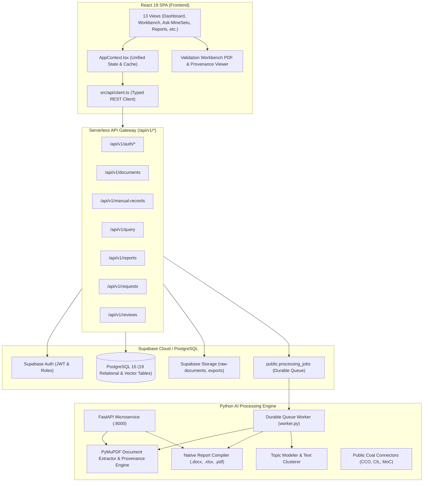

# MineSetu AI — Six-Phase Implementation Plan & Architecture Specification

> **Document Type:** Master Engineering Implementation Plan & Architecture Roadmap  
> **Status:** Active Implementation  
> **Target Release:** Controlled Beta v1.2.0  
> **Last Updated:** October 13, 2026  

---

## 1. Executive Mission & Scope Boundary

MineSetu AI is an integrated, evidence-grounded intelligence and decision-support layer for the Indian Coal Sector, covering Coal India Limited (CIL), its operational subsidiaries (ECL, SECL, BCCL, NCL, CCL, WCL, MCL), the Central Mine Planning & Design Institute (CMPDI), and the Ministry of Coal (MoC).

This plan operationalizes the transition from an isolated prototype to an integrated, evidence-grounded production platform across six sequential phases:
- **Phase 0:** Control Plane, Baseline & Progress Tracking (Current)
- **Phase 1:** Real API Integration, Authentication & Persistence
- **Phase 2:** Document Ingestion, Python AI Engine & Durable Workers
- **Phase 3:** Real Evidence Retrieval, RAG & Grounded Answers
- **Phase 4:** Native Report Generation, Topic Analysis & Analytics
- **Phase 5:** Public Coal-Sector Data Connectors & Ingestion
- **Phase 6:** Source Viewer, Complete Integration & Beta Release Validation

---

## 2. Target Architecture & Component Topology

---

## 3. Six-Phase Milestone Roadmap & Dependencies

### Phase 1: Real API Integration, Authentication & Persistence
- **Goal:** Connect React frontend modules to their real serverless API endpoints (`/api/v1/*`) and PostgreSQL database. Eliminate silent local-only persistence.
- **Dependencies:** Supabase schema migrations 001–003, `backend/functions/api/v1/*`.
- **Key Tasks:**
  1. Connect `AppContext.tsx` mutations (`uploadDocument`, `addManualRecord`, `createRequest`, `respondToRequest`, `createReportDraft`, `updateExtractedField`, `setDocumentStatus`) to call `api/client.ts`.
  2. Implement initial remote data hydration in `AppContext.tsx` with offline/demo cache fallback.
  3. Verify Vite local development proxy and API routing.
  4. Enforce server-side RBAC across 4 personas (`ministry_official`, `cil_executive`, `cmpdi_expert`, `subsidiary_officer`).
  5. Prevent tenant data leakage across subsidiaries (ECL, SECL, BCCL).
  6. Add audit logging for uploads, status updates, and field verifications.

### Phase 2: Document Ingestion, Python AI Engine & Durable Workers
- **Goal:** Connect Python processing service and document extraction libraries to the real application workflow.
- **Dependencies:** Phase 1 API integration, PyMuPDF, `processing_jobs` durable queue.
- **Key Tasks:**
  1. Wire document upload intent and confirmation to Supabase Storage and `processing_jobs`.
  2. Implement durable worker processing loop with atomic claiming (`claim_processing_job`), heartbeat renewal, and completion.
  3. Support text PDF extraction with page coordinates and normalized bounding boxes `[0..1000]`.
  4. Implement scanned page detection and honest OCR integration boundary reporting.
  5. Normalize coal-sector metrics (coal production, OB removal, ash content, stripping ratio).
  6. Validate numbers with deterministic rules and route unverified figures to human validation.

### Phase 3: Real Evidence Retrieval, RAG & Grounded Answers
- **Goal:** Ground Ask-MineSetu conversational retrieval on authoritative, verified records and documents.
- **Dependencies:** Phase 1 & 2 persistence and extraction.
- **Key Tasks:**
  1. Populate `document_chunks` and retrieval records from processed documents and approved operational records.
  2. Implement hybrid retrieval: exact SQL queries for structured figures + vector/keyword search for document text.
  3. Enforce rule: **"No Evidence, No Final Answer"** with honest disclosure of missing periods.
  4. Ensure all citations link to verified document IDs and source pages.
  5. Implement 3-tier LLM failover with clean fallback to deterministic retrieval.
  6. Prevent prompt injection and cross-tenant evidence leakage.

### Phase 4: Native Report Generation, Topic Analysis & Analytics
- **Goal:** Generate genuine `.docx`, `.xlsx`, and `.pdf` reports from verified records and connect topic intelligence to actual documents.
- **Dependencies:** Phase 2 extraction and Phase 3 retrieval.
- **Key Tasks:**
  1. Wire report generation UI to backend report compilation API.
  2. Execute native file generation using `python-docx`, `openpyxl`, and `ReportLab`.
  3. Validate arithmetic consistency (totals, stripping ratios, variances).
  4. Store exports in private storage with authenticated download links.
  5. Connect topic analysis to real ingested document corpora.

### Phase 5: Public Coal-Sector Data Connectors & Ingestion
- **Goal:** Replace static dictionary mock responses with verified ingestion for selected public coal sources.
- **Dependencies:** Phase 1 persistence, Phase 2 data model.
- **Key Tasks:**
  1. Inventory and classify 27 cataloged coal portals.
  2. Implement live, verified ingestion for key official public datasets (e.g. CCO Monthly Returns, CIL Production Statistics).
  3. Enforce provenance, SHA-256 integrity, timestamping, and idempotent deduplication.
  4. Detect conflicts between official portal figures and subsidiary returns.
  5. Display connector freshness, run history, and explicit unverified labels in UI.

### Phase 6: Source Viewer, Complete Integration & Beta Release Validation
- **Goal:** Deliver full document inspection experience with normalized bounding boxes, end-to-end integration, and release gate verification.
- **Dependencies:** Phases 1–5.
- **Key Tasks:**
  1. Implement PDF page viewer in Validation Workbench with source page rendering and bounding box overlay.
  2. Complete full end-to-end user journey across all 4 personas.
  3. Execute automated test matrix (Unit, Node, Python, E2E, Security).
  4. Finalize `PROGRESS.md`, `CHANGELOG.md`, `BETA_TEST_PLAN.md`, and `IMPLEMENTATION_REPORT.md`.
  5. Evaluate release readiness gate.

---

## 4. Acceptance Criteria & Release Thresholds

| Phase | Core Deliverable | Acceptance Threshold |
| :--- | :--- | :--- |
| **Phase 0** | Baseline tracking & documentation | All progress files created; baseline test results recorded. |
| **Phase 1** | Real API integration & persistence | UI mutations call real API; records persist across reload; RBAC enforced. |
| **Phase 2** | Document ingestion & durable queue | PDF upload creates job; PyMuPDF extracts metrics with page coordinates; human review persists. |
| **Phase 3** | Grounded RAG & citations | "No Evidence, No Final Answer"; exact citations to real docs; prompt injection blocked. |
| **Phase 4** | Native report generation | Valid `.docx`, `.xlsx`, `.pdf` files generated from real database records. |
| **Phase 5** | Public coal connectors | Tested official datasets imported with provenance; status transparent. |
| **Phase 6** | End-to-end beta validation | Full 13-step beta journey passes; zero critical security defects; clean tests. |
